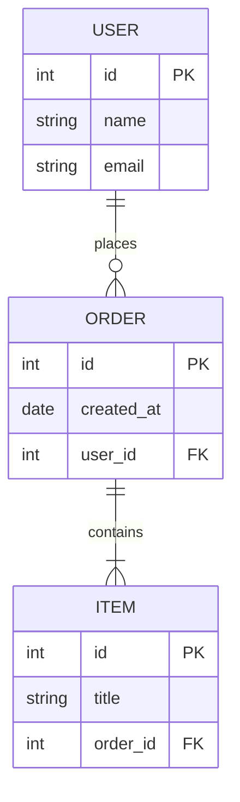

# SchemaFlow
SchemaFlow helps developers write database schema code and instantly visualize it as an ER diagram. I want to build it because large database designs are hard to understand from code alone, especially when many tables and relationships are involved.

## Architecture / How it Works

